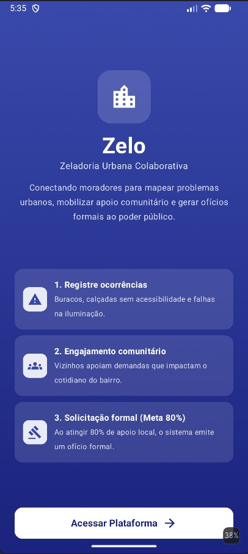
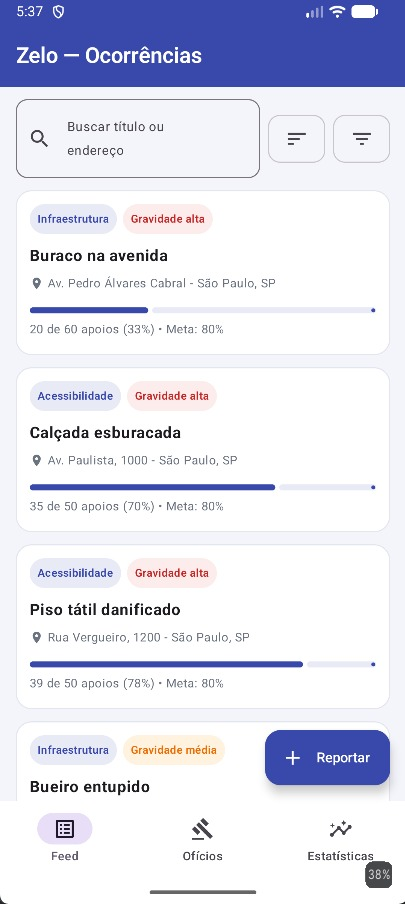
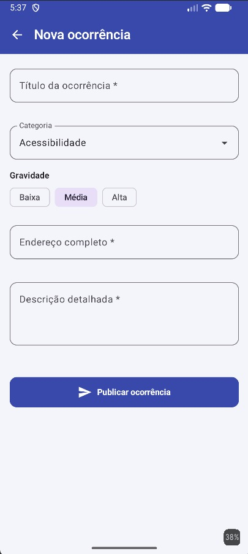
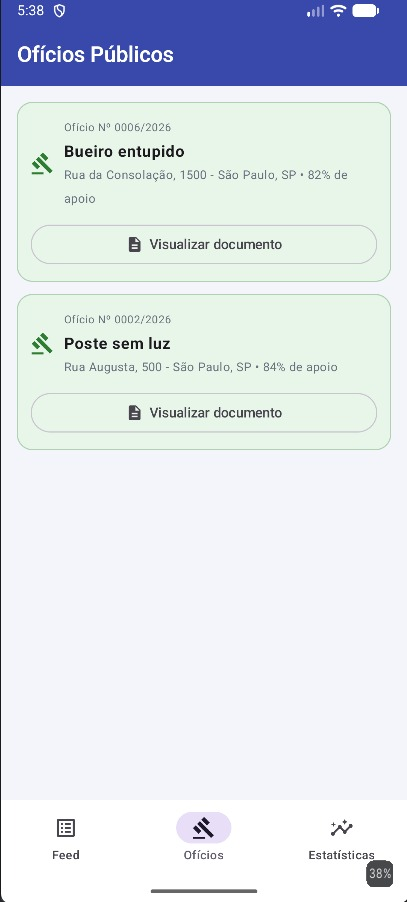
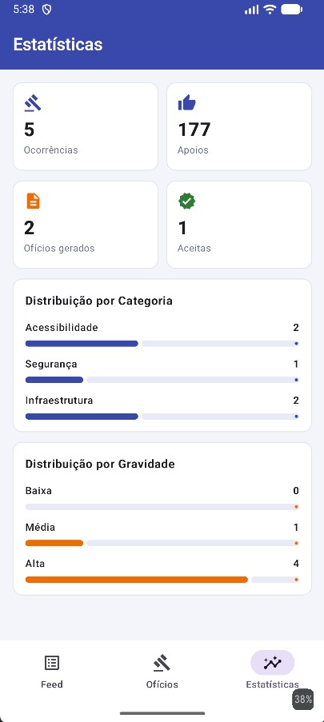

# Zelo — Zeladoria Urbana Colaborativa

*Global Solution 2026 — 2º Semestre | Android Kotlin Developer (FIAP)*  
*Desafio:* CitizenTech — Tecnologia que melhora a vida das pessoas

## Integrantes da Equipe
- *Nome Completo:* Matheus Amaral — *RM:* 557686
- *Nome Completo:* Anaí Villca Rojas — *RM:* 559049

---

## 1. Problema e Público Beneficiado
- *Problema:* Problemas cotidianos de zeladoria urbana — como calçadas esburacadas, falta de rampas de acessibilidade, iluminação pública precária e bueiros entupidos — frequentemente permanecem sem solução por falta de canais transparentes e de comprovação da relevância coletiva da demanda.
- *Público Beneficiado:* Moradores, pedestres, pessoas com deficiência ou mobilidade reduzida, idosos e associações de bairro que dependem da infraestrutura urbana segura e acessível.

## 2. Proposta da Solução
O *Zelo* é um aplicativo Android de participação cidadã em que moradores registram problemas urbanos categorizados por área e gravidade, enquanto vizinhos da mesma região apoiam as ocorrências que impactam seu dia a dia. Quando uma ocorrência atinge *80% de apoio* dos moradores ativos da região, o aplicativo altera automaticamente seu status para *"Solicitação Formal Gerada"* e emite um *Ofício Público* numerado e com código de autenticação para encaminhamento ao poder público.

## 3. Objetivos de Desenvolvimento Sustentável (ODS — ONU)
- *ODS 11 — Cidades e Comunidades Sustentáveis:* Promove a urbanização inclusiva, segura e participativa, fortalecendo o planejamento e a manutenção dos espaços públicos urbanos pelos próprios cidadãos.
- *ODS 10 — Redução das Desigualdades:* Prioriza demandas de acessibilidade urbana (rampas, piso tátil, calçadas), garantindo mobilidade digna para pessoas com deficiência e idosos.

## 4. Funcionalidades Implementadas
- *Tela Inicial de Contextualização:* Apresentação da identidade visual e fluxo de funcionamento do Zelo.
- *Feed de Ocorrências:* Listagem dinâmica com busca textual, ordenação (mais recentes, mais apoiadas, perto da meta, mais urgentes) e filtros combinados por categoria, gravidade, participação e emissão de ofício.
- *Cadastro com Validação:* Formulário para reporte de novas ocorrências com validação de campos obrigatórios (título, endereço e descrição).
- *Detalhamento, Apoio Comunitário e Ofício Formal:* Barra de progresso até a meta de 80%, botão de apoio/desfazer apoio com atualização automática de status, geração e visualização de Ofício Formal, linha do tempo do histórico, comentários comunitários e exclusão de registros.
- *Aba de Ofícios e Estatísticas:* Consulta rápida aos ofícios emitidos e painel gerencial com indicadores por categoria e gravidade.
- *Persistência Local:* Armazenamento completo via *Room* (SQLite), mantendo registros, apoios e comentários salvos após fechar e reabrir o aplicativo.

## 5. Tecnologias Utilizadas
- *Linguagem:* Kotlin
- *Interface:* Jetpack Compose & Material Design 3
- *Navegação:* Navigation Compose
- *Arquitetura e Estado:* MVVM (ViewModel + StateFlow + Repository)
- *Persistência Local:* Room Database (@Entity, @Dao, @Database)

## 6. Como Executar o Projeto
1. Abra o *Android Studio* (versão Ladybug ou superior).
2. Selecione *File > Open* e escolha a pasta raiz deste projeto.
3. Aguarde a sincronização do Gradle baixar as dependências do Jetpack Compose e Room.
4. Execute o módulo app em um emulador Android (API 26+) ou dispositivo físico.

## 7. Demonstração e Evidências de Uso
> (Insira abaixo as capturas de tela reais do aplicativo em execução)

1. *Tela de Boas Vindas (Splash):*  
   
2. *Tela Inicial (Home/Feed de Ocorrências):*  
   
3. *Cadastro de Nova Ocorrência (Formulário):*  
   
4. *Aba de Ofícios Formais:*  
   
5. *Estatísticas:*  
   